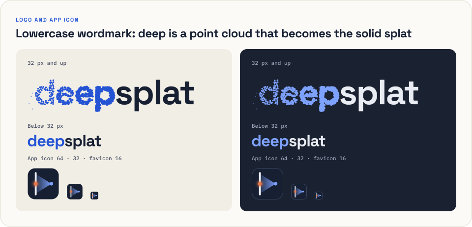
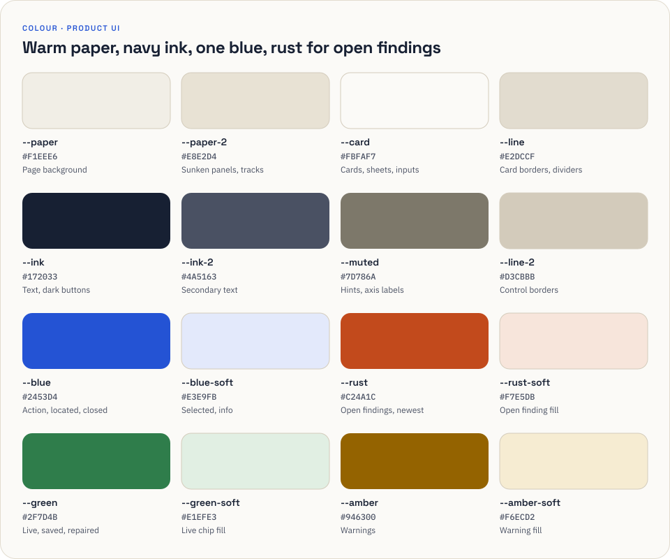
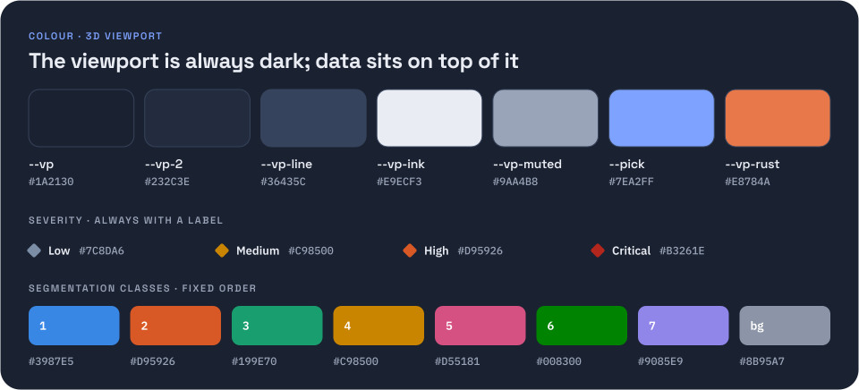
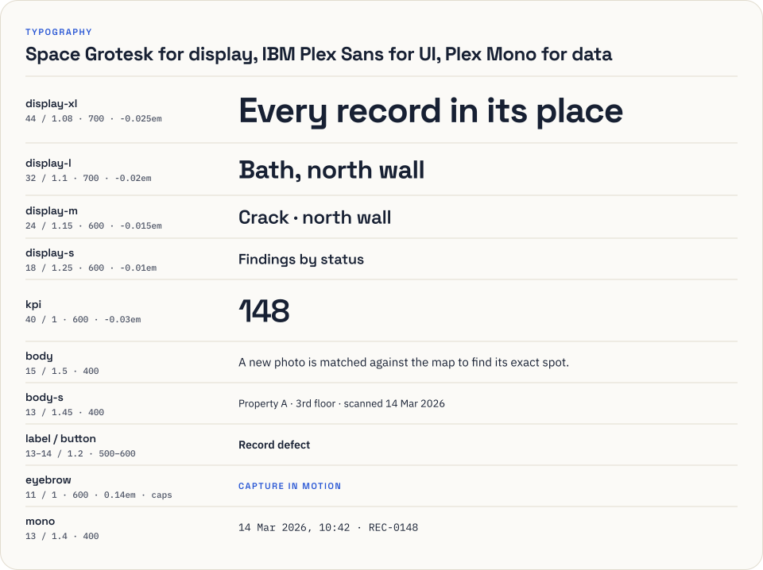
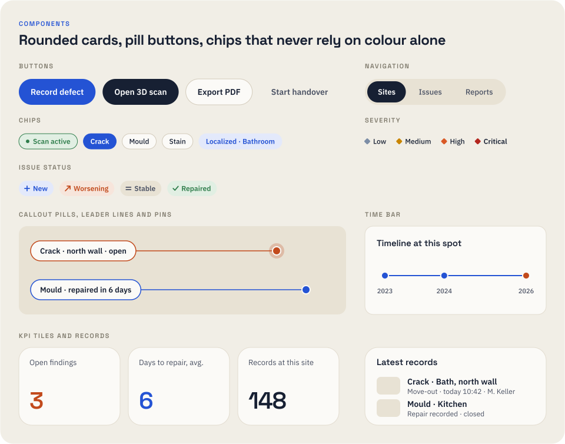
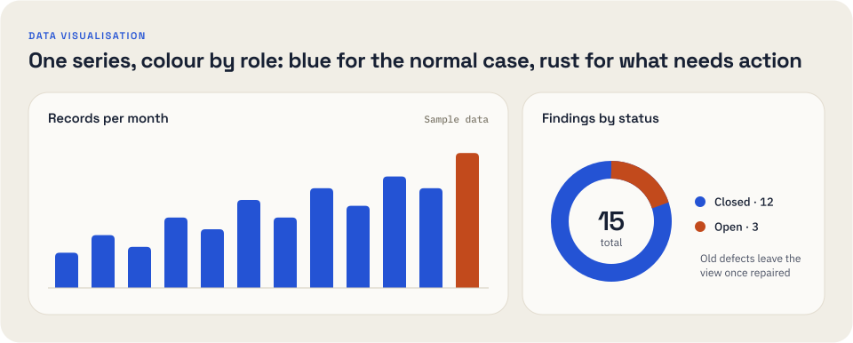
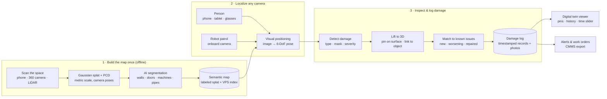

# DeepSplat

<picture>
  <source media="(prefers-color-scheme: dark)" srcset="design/brand/logos/deepsplat-wordmark-dark.svg">
  
</picture>

**Camera-based damage inspection on a living 3D twin.**

DeepSplat turns an indoor space into a photo-real Gaussian splat, labels everything in it with AI, and lets any camera (a phone, smart glasses or a robot) locate itself inside that map. Every photo of damage becomes a timestamped record pinned to its exact 3D spot, and repeat inspections show how each issue changes over time.

> One map, one localization layer, every damage record in its exact place.

---

## Design system

Everything you need to build DeepSplat screens, documents and slides. The rules are in [DESIGN.md](DESIGN.md), the tokens in
[`design/system/tokens.css`](design/system/tokens.css) and [`tokens.json`](design/system/tokens.json), the components in
[`design/system/components.css`](design/system/components.css).

To use it in another branch:

```bash
git fetch origin design-system
git checkout origin/design-system -- DESIGN.md design/system design/brand/logos
```

### Logo and app icon



Use the point-cloud wordmark at 32 px logo height or more, the solid small version below that, and the icon for square
slots. Files: [`design/brand/logos/`](design/brand/logos/).

### Colour





### Typography



### Components



### Data visualisation



---

## The problem

Inspections in factories, warehouses, plants and large buildings are still mostly manual:

- Photos end up in folders or chat threads with no reliable location ("somewhere near pump 3").
- Nobody can easily tell whether a crack is **new**, **the same one as last month**, or **getting worse**.
- Reports are hard to compare over time and hard to hand to maintenance.

## The idea

1. **Scan once.** Build a metric-scale Gaussian splat (plus a point cloud) of the space.
2. **Understand the scan.** AI segmentation labels walls, floors, doors, machines and pipes, so every surface belongs to a named object.
3. **Localize any camera.** A new photo is matched against the map to get its exact 6-DoF pose (position and heading).
4. **Detect, place and log damage.** AI finds damage in the photo, the pose lifts it onto the 3D surface, and a timestamped record is stored on that spot and linked to the object it belongs to.
5. **Track over time.** New findings are matched to existing issues, so each issue has a history: new, worsening, stable or repaired.

Inspectors on foot, people wearing smart glasses and patrolling robots all feed the **same map and the same issue log**.

---

## System overview



---

## Inspect & log damage, in detail

This is the core of DeepSplat. Each image goes through the same pipeline, whoever or whatever took it.

### 1. Capture

| Source | How it captures | Typical use |
|---|---|---|
| Inspector with phone or tablet | Takes a photo of a problem they see | Ad-hoc reports, audits |
| Smart glasses | Hands-free photo by voice or button | Walkdowns while working |
| Robot patrol | Photos at fixed waypoints on a schedule | Repeatable, comparable inspections |
| Fixed cameras (later) | Periodic frames from known poses | Constant monitoring of hot spots |

Each upload carries the image, the camera intrinsics, the device ID, a timestamp and, where available, the device's own tracking pose.

### 2. Localize the image

- The image is matched against the map to get a **6-DoF pose** in the splat's coordinate frame.
- Live devices localize once, then use on-device tracking between fixes. Every capture still gets an exact pose.
- **Quality gate:** images that are blurry, too dark or below a pose-confidence threshold are rejected or flagged, so bad positions never enter the log.

### 3. Detect and classify damage

- A detection or segmentation model finds damage regions in the photo and returns a **pixel mask**, a **type** and a **confidence**.
- Starting damage classes:
  `crack` · `corrosion / rust` · `leak / stain` · `dent / deformation` · `missing or loose part` · `exposed wiring` · `coating damage` · `obstruction / spill`
- **Severity** (low / medium / high / critical) comes from the type, the estimated size (see step 4) and where it is (a crack on a load-bearing wall ranks above one on a partition).
- A human can confirm, correct or reject every finding. Those corrections become training data.

### 4. Lift the damage into 3D

This is what makes a photo a placed record rather than a loose picture.

1. Render a **depth map from the splat** (or raycast the point cloud) at the image's pose.
2. Back-project the damage mask's pixels with that depth to get **3D points on the real surface**.
3. From these points, compute:
   - the **3D centroid** (where the pin goes),
   - the **surface area** in m² and **length** in m (for cracks), using the map's metric scale,
   - the **object it belongs to**, using the segmentation labels (e.g. "Pump P-03, housing").
4. Store the 3D region so later inspections can compare against it.

### 5. Match against known issues (change tracking)

New findings are compared with open issues before anything is logged:

- **Same issue?** Close in 3D (for example within 15 cm), on the same object and of the same type → it's an **observation** of an existing issue.
- **Growing?** Compare area or length with the last observation → mark the issue **worsening** and raise its severity if it crosses a threshold.
- **Gone?** A confident view of the spot shows no damage → suggest **repaired** for a human to confirm.
- Otherwise → create a **new issue**.

Each issue therefore has a timeline of photos and measurements, not a pile of duplicate reports.

### 6. Store the record

```json
{
  "issue_id": "ISS-0142",
  "status": "worsening",
  "type": "crack",
  "severity": "high",
  "object": { "id": "pump-p03", "label": "Pump P-03 housing" },
  "position_m": [12.41, 3.08, 1.12],
  "observations": [
    {
      "obs_id": "OBS-0911",
      "timestamp": "2026-11-14T16:42:10Z",
      "source": { "kind": "robot", "device_id": "patrol-02" },
      "camera_pose": { "t": [11.2, 2.4, 1.5], "q": [0.0, 0.0, 0.71, 0.70] },
      "pose_confidence": 0.93,
      "image_url": "s3://deepsplat/obs/OBS-0911.jpg",
      "mask_url": "s3://deepsplat/obs/OBS-0911_mask.png",
      "length_m": 0.34,
      "area_m2": 0.012,
      "detector_confidence": 0.88,
      "reviewed_by": null
    }
  ]
}
```

### 7. View, alert and act

- **Digital twin viewer:** the splat in the browser with a pin on every issue, colored by severity. Click a pin to see its photo timeline and a before/after comparison. A **time slider** shows the state of the building on any date.
- **Filters:** by area, object, damage type, severity, status or source.
- **Alerts:** new high-severity issues or fast-growing ones notify the responsible team.
- **Work orders:** export issues to maintenance systems (e.g. SAP PM, IBM Maximo) or as a PDF/CSV inspection report.
- **Asset history:** every machine or room gets its full damage history in one place.

---

## Suggested tech stack

| Layer | Options |
|---|---|
| Capture & scanning | Phone/LiDAR scan apps, 360 camera, XGRIDS or similar scanners |
| Splat training | nerfstudio / gsplat, or the scanner vendor's pipeline (must be metric scale) |
| 3D segmentation | Grounding DINO + SAM 2 on training views, lifted to Gaussians (e.g. Gaussian Grouping-style labeling) |
| Visual localization | hloc (NetVLAD retrieval + SuperPoint/LightGlue + PnP) using the splat's training images, or a hosted VPS such as MultiSet |
| Damage detection | YOLO-seg or SAM 2 fine-tuned on damage datasets, with an open-vocabulary detector for rare classes |
| Geometry | Open3D, NumPy, splat depth rendering |
| Backend | FastAPI, PostgreSQL, object storage for images |
| Viewer | Three.js with a Gaussian splat renderer (e.g. GaussianSplats3D) |
| Clients | Native iOS/Android (ARKit/ARCore) for live pose; robots via REST/ROS 2 |

---

## Hackathon MVP (2 days)

Keep the scope to one room or corridor and prove the full loop.

**Day 1: map and localization**
- [ ] Scan the demo area and train a metric-scale splat with camera poses
- [ ] Label 3–5 objects (wall, door, machine) in the splat
- [ ] Localization endpoint: `POST /localize` (image → pose) using the training images
- [ ] Web viewer that loads the splat and shows a camera frustum at a returned pose

**Day 2: damage pipeline and demo**
- [ ] `POST /inspect` endpoint: localize → detect → lift to 3D → match → store
- [ ] Damage detector for 2–3 classes (e.g. crack, rust, leak), with prepared test images
- [ ] Pins in the viewer, colored by severity, with a photo popup
- [ ] Repeat a capture to show "same issue, new observation" and a status change
- [ ] Demo script: phone photo of damage → pin appears in the twin within seconds

**Demo tip:** show the phone camera on one side and the splat on the other, so judges see each photo land on the right spot in 3D.

---

## Roadmap after the hackathon

- Scheduled robot patrol routes with identical viewpoints for clean before/after comparisons
- Severity models trained on customer-specific damage types
- Automatic re-scanning and map versioning when the space changes
- On-premise deployment for sites where images can't leave the network
- Integrations with CMMS / EAM systems and attached asset documents (age, service history, past faults)

## Open challenges

- **Localization in repetitive or low-texture areas** (identical corridors, blank walls)
- **Lighting changes** between scan time and inspection time
- **Detector false positives** (stains vs. leaks, shadows vs. cracks); keep a human review step
- **Privacy** on sites with workers; blur people and faces before storing images
- **Map drift** when equipment moves; needs periodic rescans

## Proposed repository structure

```
deepsplat/
├── mapping/        # splat training, scale alignment, segmentation lifting
├── localization/   # VPS index build + /localize service
├── inspection/     # damage detection, 3D lifting, issue matching
├── backend/        # FastAPI app, database models, storage
├── viewer/         # Three.js splat viewer with issue pins
├── clients/        # mobile / glasses / robot capture clients
└── data/           # sample scans and test images (not committed if large)
```
