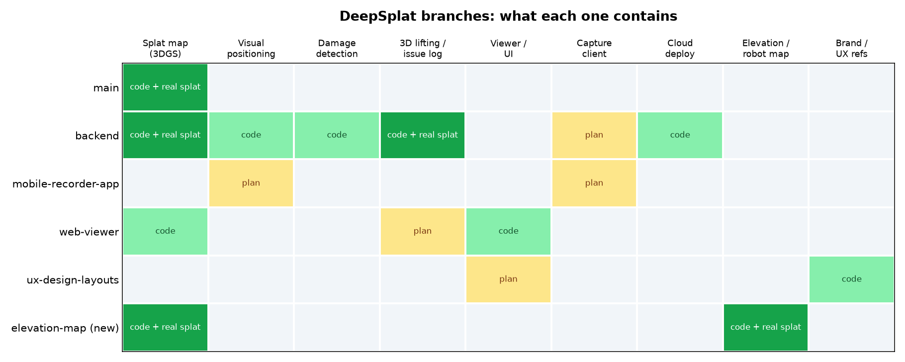
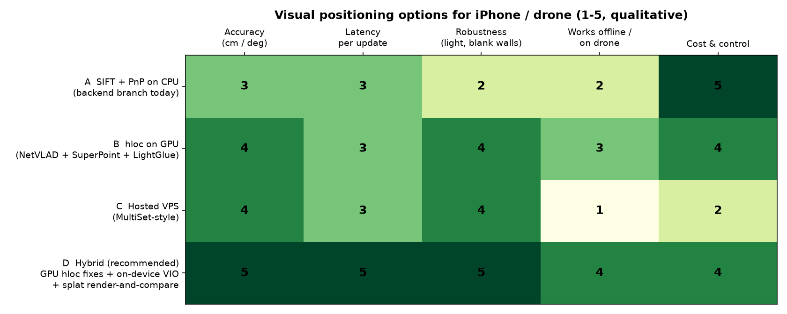

# Branch comparison, VPS recommendation and the elevation map

## 1. What each branch does

| Branch | Approach | Status |
|---|---|---|
| `main` | README concept + `trained_splats/splat_30000.ply` (Brush export, 3 M gaussians, SH3, 708 MB in Git LFS). | Data only |
| `backend` | FastAPI + SQLModel. Photo → quality gate → **SAM 3** (Roboflow) → **localize** → lift mask to 3D using opaque gaussian centres → match against open issues → hash-chained log. Own **VPS**: SIFT on the splat's training views, keypoint depth from the splat, 2D-3D matching + PnP/RANSAC on CPU (`localization/sift_vps.py`); `hloc` (NetVLAD + SuperPoint + LightGlue) as the GPU upgrade path. Multi-frame: 4-6 frames localized, their ARKit poses give one robust ARKit→map transform that places the close-up photo. Cloud Run + GCS + Cloud SQL deploy. | 33 tests; synthetic room < 3 cm / 0.5°, ~1 s/frame on a laptop CPU. Not yet benchmarked on the real auditorium |
| `mobile-recorder-app` | Plan for an iOS app that is a *recorder only*: 5 FPS frames + ARKit pose + intrinsics + IMU (100 Hz) + one crack photo, zipped and uploaded. Mirrors MultiSet's multi-frame query. All processing stays in the backend. | Plan only (`docs/PLAN.md`) |
| `web-viewer` | Single-file Three.js + Spark viewer ("DeepSplat Console") on mock data; backend `viewer_api.py` serves the same shape. | Prototype |
| `ux-design-layouts` | imoscan product visuals (PDF) as UX reference, logo / brand explorations. | Design assets |
| `elevation-map` (this branch) | Reads the splat from any host, fits the floor, writes elevation + traversability maps for odometry robots. | Working on the real splat |

Common thread: every branch relies on **the splat as the single map**; the only place pose is *computed* is the backend's VPS.

## 2. Best approach for VPS on iPhone / drone (accuracy first, latency second)

Scores are my qualitative judgement from reading the branches, not measurements. The backend's numbers come from a rendered synthetic room; **nothing here has been benchmarked on the real auditorium yet**.

**Recommended: hybrid, option D.**

1. **Global fix in the cloud (GPU).** Run `hloc` (NetVLAD retrieval → SuperPoint + LightGlue → PnP/RANSAC) against the training views, with keypoint depth from the splat as the backend already does. Send 4-6 frames at ≤ 1024 px with their device poses, exactly like the iOS plan. This gives an absolute 6-DoF pose in the splat frame; the target is a few hundred ms once the GPU is warm (to be measured), and the CPU SIFT version is the fallback.
2. **Between fixes, trust the device.** ARKit (iPhone) or the drone's VIO / flight controller gives smooth 30-200 Hz relative motion. The map pose is `T_map_device = T_map_odom · T_odom_device`; each VPS fix only updates the slowly-changing `T_map_odom` (the backend's `device_to_map` already is this transform). Latency the user sees is then the VIO latency, not the cloud round trip.
3. **Fuse, don't replace.** Feed fixes into a small pose-graph / EKF with outlier gating (inlier count + reprojection error; reject jumps vs. the VIO prediction). Re-localize on drift, tracking loss or low confidence.
4. **Refine for the last centimetres.** Render the splat from the VPS pose and align the live image photometrically (a few Gauss-Newton steps on the camera pose). This is where splats beat meshes and is the main accuracy lever; it is optional and should be benchmarked before it is committed to.
5. **Drone specifics.** Keep a cached index + feature extractor on a Jetson-class companion computer for offline tracking, use the cloud only for re-localization, and add the barometer / LiDAR height. Gate fixes by the floor-aligned height (the elevation map gives the expected floor height at every x, y).
6. **Latency budget.** Warm GPU instance, regional endpoint, persistent connection, downscaled JPEG/HEIC, shard the index by area (GPS / last known pose as a prior), retrieve top-k only.

## 3. How MultiSet does it, and how to get the same result

From MultiSet's public SDK description (also summarised in `mobile-recorder-app:docs/PLAN.md`; check their docs for current numbers):

* **Map:** built once from a scan (LiDAR / photogrammetry / mesh), stored in their cloud as a feature map with 3D points.
* **Query:** the app sends **4-6 images 300-800 ms apart together with the ARKit/ARCore pose of each image**; the server localizes them and returns one transform between the device's tracking frame and the map frame.
* **Why it is accurate and fast:** multiple frames add viewpoint diversity (a blank wall alone fails), the device poses over-constrain the answer and let the server reject outliers, and the result is *one rigid transform* so the app tracks locally afterwards.

DeepSplat already has the same shape: the iOS plan records the same per-frame data, and `backend` has `/localize/multi` + frame-pose alignment. The remaining gaps to MultiSet-level results are:

| Gap | Fix |
|---|---|
| CPU SIFT is weaker in lighting changes / texture-poor areas | Switch to `VPS=hloc` on a GPU instance (code exists) |
| No real-world benchmark | Capture a held-out set in the auditorium, score position/heading error and success rate per method |
| Training views must cover the area | Add views along the intended inspection paths; re-index |
| No on-device tracking fusion | Implement step 2-3 above in the iOS app / robot client |

## 4. Elevation map (`elevation-map` branch)

`python -m elevmap --splat <where> --out maps/<name>` where `<where>` is a local path, `https://…`, `github:OWNER/REPO@BRANCH/path.ply` (Git LFS), `gs://bucket/obj` or `s3://bucket/key`. Remote files are streamed with HTTP Range requests, never written to disk.

* **Floor alignment:** gravity = direction in which horizontal surfaces are sharpest (a floor is a razor-thin peak of heights), then RANSAC + SVD on the lowest dense peak. On the auditorium splat: floor plane at z = −1.163 m in the raw frame, 0.13-0.19° residual tilt removed, the aligned height histogram has a single sharp floor peak at z = 0 (see `maps/auditorium/floor_alignment.png`).
* **Outputs** (`maps/auditorium/`): `map.pgm` + `map.yaml` (ROS `map_server` / nav2), `elevation.npz` (dsm, ground, obstacle, slope, step, cost, trav), `ground_height_16bit.png`, `map_meta.json` (incl. 4×4 splat→aligned and splat→three.js y-up transforms), `ground_points.csv`, and the figures.
* **Robot:** defaults are body height 0.7 m, radius 0.25 m, max slope 20°, max step 0.15 m; all are flags.
* **Odometry robots** can load `map.yaml` directly and localize against it with their own odometry/LiDAR (AMCL), or use the elevation grid as a costmap layer.

Limitations: only the surfaces the splat reconstructed exist (unknown cells are marked unknown, not free); the 2.4 m height cap removes ceilings but would also cut a mezzanine; glass and mirrors are not reconstructed.
