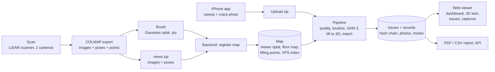

# deepsplat: technical documentation

State of the `main` branch on 16 November 2026 (commit `d45cc9e`). It follows the data from the scan
to the records a person looks at in the viewer. For step-by-step use see the
[user manual](USER_MANUAL.md).

Every statement here was taken from the code, the repository documents or the local test setup. Where
something is written but has not been run, or has only been run on test data, the text says so. Two
facts about the scan are not recorded anywhere and are marked **[not recorded]**.

## Contents

1. [What the system does](#1-what-the-system-does)
2. [Components](#2-components)
3. [Stage 1: scan](#3-stage-1-scan)
4. [Stage 2: train the splat in Brush](#4-stage-2-train-the-splat-in-brush)
5. [Stage 3: register the map](#5-stage-3-register-the-map)
6. [Stage 4: record a capture (iPhone app)](#6-stage-4-record-a-capture-iphone-app)
7. [Stage 5: upload](#7-stage-5-upload)
8. [Stage 6: the inspection pipeline](#8-stage-6-the-inspection-pipeline)
9. [Stage 7: stored data](#9-stage-7-stored-data)
10. [Stage 8: viewer](#10-stage-8-viewer)
11. [API reference](#11-api-reference)
12. [Coordinate frames and conventions](#12-coordinate-frames-and-conventions)
13. [Configuration](#13-configuration)
14. [Elevation and floor maps](#14-elevation-and-floor-maps)
15. [Tools](#15-tools)
16. [Tests](#16-tests)
17. [Deployment](#17-deployment)
18. [Current state and known limitations](#18-current-state-and-known-limitations)

---

## 1. What the system does

deepsplat keeps one 3D map of an indoor space, a Gaussian splat, and files every damage photo as a
timestamped record at its position in that map.



The same pipeline also accepts single images over the API (`POST /inspect`), which is the entry for
robots and smart glasses. No robot or glasses client exists in the repository.

## 2. Components

| Folder | Role | Language / runtime |
|---|---|---|
| `backend/` | FastAPI application: API, database models, storage, pipeline orchestration, PDF report | Python 3.12 |
| `localization/` | Visual positioning (VPS): camera conventions, frame selection, SIFT VPS, hloc VPS, frame-pose alignment | Python |
| `inspection/` | Damage classes, SAM 3 detector, lifting to 3D, placement, severity, issue matching, quality gate, hash chain, floor plan | Python |
| `elevmap/` | Floor alignment, elevation and traversability grid, floor map, ROS map export | Python |
| `viewer/` | Web viewer, one file `index.html` (three.js 0.187.0, Spark 2.4.0 splat renderer, no build step) | JavaScript |
| `clients/ios/` | iPhone capture app (SwiftUI, ARKit, no third-party packages) | Swift 5.9, iOS 16+ |
| `scripts/` | `start-backend.sh`, `register-map.sh` | bash |
| `tools/` | Benchmarks and debugging scripts | Python |
| `maps/auditorium/` | Committed elevation-map results of the project scan | data |
| `design/`, `DESIGN.md` | Design tokens, components, logos | CSS / SVG |
| `data/` | Database, splats, uploads of a local backend. Ignored by git | runtime data |

Python dependencies (`pyproject.toml`): FastAPI, uvicorn, SQLModel, pydantic-settings, requests,
Pillow, pillow-heif, NumPy, opencv-python-headless, reportlab, SciPy. Optional group `gcp`
(google-cloud-storage, psycopg) for Google Cloud. Packages are managed with `uv`.

External services: Roboflow serverless for SAM 3 (needs an API key), optionally a Cloudflare quick
tunnel (`cloudflared`) to give the backend an https address. The viewer loads three.js, Spark and
fonts from `cdn.jsdelivr.net` and Google Fonts, so the browser needs internet access.

## 3. Stage 1: scan

The project space is an auditorium. It was scanned on 14 November 2026 with a handheld LiDAR
scanner that carries two cameras. Scanner model and export software: **[not recorded]**.

The scanner export used by everything downstream is a COLMAP text model:

```
2026-11-14_20-26-01_colmap/
├── images/left/<timestamp_ns>.jpg
├── images/right/<timestamp_ns>.jpg
└── sparse/0/
    ├── cameras.txt     one camera: PINHOLE 1600 x 1600, fx = fy = 800, cx = cy = 800
    ├── images.txt      one pose per image (world to camera: quaternion + translation)
    └── points3D.txt    604,924 points
```

| Property | Value |
|---|---|
| Images | 808 (left and right camera) |
| Image size | 1600 x 1600 px, pinhole, no distortion parameters |
| Spacing | 0.5 s between consecutive timestamps |
| Points | 604,924 |

What the rest of the system needs from the scan:

* **Images with poses** in one common frame. They train the splat and later form the localization
  index.
* **Metric scale.** No step applies a scale correction. Lengths, areas, heights and all distance
  thresholds are computed directly in the scan's units and reported as metres.
* **Coverage.** A capture can only be localized where a training image has seen the area.

## 4. Stage 2: train the splat in Brush

The Gaussian splat was trained with [Brush](https://github.com/ArthurBrussee/brush) on the COLMAP
export, with Brush's default settings, for 30,000 steps, and exported as a `.ply`.

| Property of `splat_30000.ply` | Value | Source |
|---|---|---|
| Gaussians | 3,000,000 | map statistics in the backend |
| Spherical harmonics | degree 3 (`f_dc_*` + `f_rest_0..44`) | file fields |
| File size | 708 MB | file |
| Format | binary little-endian PLY, standard 3DGS fields (`x y z`, `f_dc_*`, `f_rest_*`, `opacity`, `scale_*`, `rot_*`) | file |

The file's header carries the comments `Exported from Brush`, `Vertical axis: y` and `SH degree: 3`.
The comment about the vertical axis does not match the data: the floor of this splat is a plane of
constant z (the elevation map's floor fit finds it at z = −1.16 m with under 0.2° of tilt), and the
map is registered with `up_axis: z`. Nothing in the backend reads that comment.

Brush keeps the coordinate frame of the COLMAP input. This matters: the backend requires the image
poses in `views.zip` to be in the same frame as the splat. For the project scan they are, and no
`views_to_map` transform was set.

The splat file is not in the repository any more (removed from the working tree in commit `aedd9f9`;
it remains in history through Git LFS). The backend reads it from `data/`.

`views.zip` is the COLMAP folder zipped with its structure intact (`images/…`, `sparse/0/…`),
565 MB for the project scan.

## 5. Stage 3: register the map

A *map* is one registered splat with its metadata. `scripts/register-map.sh <map-id> <splat.ply>
[views.zip] [name]` sends `POST /maps` (multipart) to the running backend.

Accepted layouts of `views.zip` (`localization/map_views.py`):

* nerfstudio: `transforms.json` with `frames[].file_path`, `frames[].transform_matrix`
  (camera to world, OpenGL axes) and intrinsics `fl_x fl_y cx cy w h`.
* COLMAP text: `sparse/0/{cameras,images}.txt` or `{cameras,images}.txt`, images under `images/`.
  Camera models `PINHOLE`, `OPENCV`, `FULL_OPENCV`, `SIMPLE_PINHOLE`, `SIMPLE_RADIAL`, `RADIAL` are
  read; distortion parameters are ignored.

Optional `metadata` JSON: `property`, `floor_label`, `scanned_at`, `up_axis` (`"z"` or `"y"`),
`north` (direction of north in the floor plane, default `[0, 1]`), `rooms`
(`[{name, polygon: [[x, y], …]}]`), `views_to_map` (4x4, if the view poses are not in the splat's
frame), `context`.

After the upload the backend processes the map in the background (`backend/pipeline.py`,
`process_map`). `GET /maps/{id}` shows `status` and `vps_status`.

| Product | How it is made | Stored as |
|---|---|---|
| Lifting points | Centres of all gaussians with opacity ≥ 0.2, plus their index in the splat | `maps/<id>/proj.npz` |
| Floor height `floor_z` | 2nd percentile of the lifting points' height, unless given in the metadata | database |
| Viewer splat | Gaussians with opacity ≥ 0.05, base colour only (the `f_rest_*` fields are dropped) | `maps/<id>/splat_viewer.ply` |
| Floor plan | Top-down colour render of everything between the floor and a cut height | `maps/<id>/floor_plan.png` |
| Floor map | Clean plan: floor, raised levels, furniture, walls (see [section 14](#14-elevation-and-floor-maps)) | `maps/<id>/floor_map.png` |
| VPS index | SIFT keypoints of every training image with a 3D position from the splat (below) | `data/vps/<id>/index.npz`, `index.json` |

Values for the project map `auditorium` on the local backend:

| | |
|---|---|
| Lifting points | 984,630 of 3,000,000 gaussians |
| Viewer splat | 2,478,666 gaussians, 139 MB |
| `up_axis`, `floor_z` | `z`, −1.155 m |
| Bounds (1st to 99th percentile) | x −3.86 … 11.19, y −6.31 … 11.80, z −1.18 … 5.31 m |
| VPS index | 808 views, 1,369,166 keypoints with depth, median 1,820 per view, 2 views without any |
| Rooms | none defined |

### How the VPS index is built (`localization/sift_vps.py`)

For every training image: downscale so the longer side is at most 1024 px, extract up to 2,000 SIFT
keypoints, project the lifting points into the image to get the nearest surface depth per 2 px cell,
and back-project each keypoint with that depth. The result is one table of (descriptor, 3D point).
Keypoints without a depth are dropped. No GPU is used.

## 6. Stage 4: record a capture (iPhone app)

The app (`clients/ios/`) is a recorder and uploader. It does no localization or detection and shows
no results, only the upload and processing status.

One capture is a short video sweep plus one high-resolution photo of the damage, all in one ARKit
world-tracking session so that every frame and the photo share one metric coordinate frame.

| Recorded | Default | Setting range |
|---|---|---|
| Video frames, JPEG | 5 per second, quality 90 % | 1 to 15 fps, 50 to 100 % |
| Crack photo, JPEG quality 95 % | ARKit high-resolution frame, else the current camera frame | |
| Per frame and photo | timestamp, ARKit camera-to-world matrix, intrinsics, tracking state | |
| Accelerometer, gyroscope, device motion (CSV) | 100 Hz | 25 to 100 Hz |
| One GPS fix at the start | off | on / off |
| Maximum duration | 20 s | 5 to 60 s |

Images are stored exactly as the sensor delivers them (landscape, no rotation, no EXIF orientation
tag). The backend rotates them upright. The frame resolution is whatever ARKit delivers on the
device and is not fixed in the code.

Capture folder, zipped for upload:

```
capture.json           manifest, schema_version 1
frames/000001.jpg …    video frames
photo.jpg              the damage photo
imu/accel.csv, gyro.csv, motion.csv
log.txt
```

`capture.json` holds `capture_id` (UUID), `map_id`, `created_unix`, `device`, `ios_version`,
`app_version`, `time_base`, `uptime_to_unix_offset`, `conventions`, `video` (`fps_target`,
`source_fps`, `duration_s`, `frames[]`), `photo`, `imu`, `geo`. Each frame record has `file`, `t`
(seconds of system uptime), `camera_to_world` (16 numbers, row-major), `intrinsics`
(`fx fy cx cy width height` for the stored image), `interface_orientation` (always `portrait`) and
`tracking_state`.

To save a capture the app needs at least one video frame, the photo, a map ID and at least one
sample in each motion stream. `clients/ios/Scripts/validate_capture.py <zip>` checks a capture file
against these rules.

The backend does not use the IMU files or the GPS fix for localization; `geo` is stored with the
capture.

## 7. Stage 5: upload

The app uploads only when the user taps **Upload capture**. Protocol (all relative to the Backend
URL, with `Authorization: Bearer <token>` except the PUT):

| Step | Request | Result |
|---|---|---|
| 1 | `POST /v1/captures` `{capture_id, map_id, size_bytes, created_unix}` | `{upload_url, expires_at}`. Creates the capture record, status `awaiting_upload`. Repeating it with the same id is allowed |
| 2 | `PUT <upload_url>` with the zip | Local storage: the backend itself receives it at `/v1/uploads/uploads/<id>.zip`. Google Cloud: a signed bucket URL |
| 3 | `POST /v1/captures/{id}/complete` | `202 {"status": "processing"}`. Starts the pipeline in the background |
| 4 | `GET /v1/captures/{id}` | `{status: uploaded | processing | done | failed, detail, error}` |

The `upload_url` starts with the backend's `PUBLIC_BASE_URL`, so that setting must be an address the
phone can reach. `scripts/start-backend.sh` sets it to the tunnel address, the `--host` name, or the
machine's IP.

The app accepts `https` for any host and plain `http` only for private-network hosts (`localhost`,
`*.local`, `10.x`, `172.16–31.x`, `192.168.x`, `169.254.x`, `127.x`). The transfer runs on a
background URL session; one upload at a time; failed uploads retry after 2, 4, 8 … seconds, at most
every 5 minutes.

In the app's status every backend state that is not `uploaded`, `processing` or `failed` is reported
as `done`. A capture that could not be localized (`needs_localization`, `needs_review`) therefore
shows as done in the app; the reason is visible in the viewer.

## 8. Stage 6: the inspection pipeline

`backend/pipeline.py`. The same steps run for an app upload, for `POST /inspect` and after
`POST /captures/{id}/registration`.

```
read zip → quality gate → localize → detect (SAM 3) → gates → lift to 3D → match issues → store
```

### 8.1 Read the package (`backend/package.py`)

Rejects zips with unsafe paths, more than 500 MB uncompressed, a missing `capture.json`, a
`schema_version` other than 1 or a missing photo. Frames are chosen from the metadata before any
image is read (`localization/frames.py`): tracking state `normal`, at least 0.5 s apart, at most 12
spread evenly over the capture. The chosen frames and the photo are rotated upright
([section 12](#12-coordinate-frames-and-conventions)) and stored under `captures/<id>/`.

### 8.2 Quality gate (`inspection/quality.py`)

On a 512 px grey copy of the photo: sharpness = variance of the Laplacian, flag `blurry` below 30;
brightness = mean grey value, flag `too_dark` below 35. With `REJECT_LOW_QUALITY_IMAGES=false`
(default) a flagged photo continues, and the capture ends as `needs_review` after localization. With
`true` it ends as `rejected` at once.

### 8.3 Localize

Three sources, in this order:

1. **Pose from the client.** `/inspect` with `camera_to_map`: used as given, confidence 1.0 unless
   the client sends one.
2. **VPS on the video frames** (the app's case). Each selected frame is localized on its own. The
   frames' ARKit poses then carry the result to the photo.
3. **VPS on the photo alone**, when there are no frames, no device pose, or no frame localized.

**Single-image query** (`localization/sift_vps.py`): downscale to 1024 px, up to 4,000 SIFT
keypoints, 6 nearest neighbours in the index (FLANN), ratio test 0.8 against the nearest neighbour
that is a *different* 3D point (more than 10 cm away), then PnP with RANSAC (4 px reprojection
error, 5,000 iterations) and a refinement on the inliers. Fewer than 25 inliers: no result.
Single-image confidence = `min(1, inliers / 150)`.

**Multi-frame consensus** (`localization/alignment.py`): every localized frame `i` proposes one
transform from the ARKit session frame to the map, `T_i = C_map_i · C_device_i⁻¹`. The proposal that
the most frames agree with wins; a frame agrees when its camera centre lands within 0.30 m and its
orientation within 3° of its own VPS result. The final transform is refitted on the agreeing group
(mean rotation, median translation of the camera centres). The photo's pose is
`C_map_photo = T · C_device_photo`.

**Multi-frame confidence** (`localization/vps.py`):

```
agreement  = (agreeing frames / localized frames) · min(1, agreeing frames / 3)
confidence = agreement · min(1, median inliers of the localized frames / 40)
```

The pose, the method, the confidence, each frame's own VPS pose and the list of frames that failed
are stored in the capture's `localization` field. The viewer's Debug group shows them.

### 8.4 Detect (`inspection/detection/roboflow_sam3.py`)

One request to `https://serverless.roboflow.com/sam3/concept_segment` with the upright photo and the
text prompts of all enabled damage classes; results come back as polygons. HTTP 429 and 5xx are
retried up to three times; the request timeout is 60 s. Detections below the class threshold are
dropped, and near-identical masks from several prompts are reduced to the most confident one
(bounding-box IoU ≥ 0.8).

Enabled on `main`: only **crack** (prompt `crack`, minimum confidence 0.45). Mould, stain, scratch,
peeling paint, hole, corrosion, dent, exposed wiring and obstruction/spill are defined in
`inspection/classes.py` with `enabled: False`. "Missing part" has no prompt.

Detection runs even when localization failed, so the 2D findings are kept. For each detection the
backend stores a mask PNG, and for the capture an overlay JPEG and the raw response.
`DETECTOR=fake` replaces the service with a built-in stand-in for offline work and tests.

### 8.5 Gates before anything is logged

| Condition | Capture status | Stage shown |
|---|---|---|
| No pose (no map, no index, VPS failed) | `needs_localization` | stopped at "Localized (VPS)" |
| Map not ready | `needs_localization` | same |
| Confidence below `MIN_POSE_CONFIDENCE` (default 0.5) | `needs_review` | same |
| Photo flagged by the quality gate | `needs_review` | stopped at "Segmented (SAM 3)" |
| Any exception (for example SAM 3 unreachable) | `failed`, with the error text | |

In all of these cases no issue and no record is created.

### 8.6 Lift to 3D (`inspection/lifting.py`)

1. Project all lifting points into the photo. A point is visible if its depth is within 5 % of the
   nearest depth in its image cell or a neighbouring cell (a coarse z-buffer; the cell size is
   `max(4, width / 240)` px).
2. Keep the visible points that fall inside the detection's mask. Fewer than 5: the detection is
   not placed.
3. From those points:
   * **position** = median,
   * **extent** = 2nd to 98th percentile box,
   * **normal** = direction of least spread (SVD), turned towards the camera,
   * **length** = extent along the direction of largest spread (2nd to 98th percentile),
   * **area** = mask area in pixels · (mean depth)² / (fx · fy). This ignores the tilt of the
     surface.

There is no rendered depth map; the gaussian centres stand in for the surface.

### 8.7 Place (`inspection/placement.py`)

* **Room:** the room polygon that contains the position, else the nearest one within 30 cm.
* **Surface:** `floor` if the normal points up (z component > 0.7), `ceiling` if down (< −0.7),
  otherwise `north | east | south | west wall` from the normal and the map's `north`.
* **Height** above the floor (`floor_z`, or the room's own).

### 8.8 Match and severity (`inspection/issues.py`, `inspection/severity.py`)

A detection is an observation of an existing open issue when the type is the same and the two are
within 15 cm: centroid to centroid, or one centroid to the other's 3D extent. Otherwise a new issue
is created.

* **Size** is the length for cracks and scratches and the area for all other types.
* **Worsening:** size more than 20 % larger than before and by at least 2 cm (length) or 20 cm²
  (area). Otherwise **stable**.
* **Severity:** the type's base level (crack: medium), one level up above 0.5 m or 0.1 m², two above
  1.5 m or 0.5 m², one more if the object label contains a structural keyword (column, beam,
  load-bearing, …). An existing issue keeps the highest level reached unless a person set it.
* **Repair suggested:** an open issue of an enabled type that is within 4 m, faces the camera and
  is visible in a capture that produced no matching finding gets `repair_suggested`. A person
  confirms the repair.

Reprocessing a capture marks its earlier records `superseded`; they stay in the hash chain.

### 8.9 Evidence (`inspection/evidence.py`)

Each record gets a SHA-256 hash over its content (ids, type, timestamps, position, sizes, the
photo's SHA-256, recorder, event, device) and the previous record's hash of the same map. The first
record links to 64 zeros. `GET /maps/{id}/verify` recomputes the chain and reports where it breaks.
The upload's own SHA-256 is stored with the capture.

## 9. Stage 7: stored data

Database (`backend/models.py`): SQLite at `data/deepsplat.db` by default, PostgreSQL through
`DATABASE_URL`. Tables are created at startup.

| Table | One row is | Key fields |
|---|---|---|
| `map` | a registered splat | `id`, `name`, `status`, `up_axis`, `north`, `floor_z`, `rooms`, storage keys, `vps_status`, `stats` |
| `capture` | one input (zip or image) | `id`, `map_id`, `status`, `stage`, `error`, `quality`, `localization`, `frames`, `original_sha256` |
| `detection` | one SAM 3 mask in a photo | `damage_class`, `prompt`, `confidence`, `bbox`, `polygons`, `mask_key` |
| `issue` | one damage at one place | `seq` (`ISS-0001`), `damage_class`, `status`, `severity`, `position`, `normal`, `room`, `surface`, `height_m`, `size`, `first_seen`, `last_seen`, `repair_suggested` |
| `observation` | one record of an issue | `seq` (`OBS-0001`), `issue_seq`, `capture_id`, `timestamp`, camera pose, `length_m`, `area_m2`, `change`, `review`, `record_hash`, `prev_hash` |
| `handover` | a move-in / move-out walkthrough | `kind`, `tenant`, `status` |

Capture `status`: `awaiting_upload`, `uploaded`, `processing`, `done`, `needs_localization`,
`needs_review`, `rejected`, `failed`. Capture `stage`: 0 upload, 1 localize, 2 detect, 3 place in
3D, 4 match, 5 done. Issue `status`: `new`, `worsening`, `stable` (open), `repaired`, `rejected`
(closed).

Files (`backend/storage.py`), under `data/blobs/` locally or in a bucket:

```
uploads/<capture-id>.zip                     the upload as received
captures/<capture-id>/photo.jpg              upright photo
captures/<capture-id>/frames/<n>.jpg         frames kept for localization
captures/<capture-id>/mask_<detection>.png   one mask per detection
captures/<capture-id>/overlay.jpg            photo with all masks
captures/<capture-id>/detection_raw.json     SAM 3 response
captures/<capture-id>/obs_<n>_points.json    up to 5,000 3D points of the record
captures/<capture-id>/obs_<n>_gaussians.json indices of those gaussians in the splat
maps/<map-id>/splat.ply, views.zip, proj.npz, splat_viewer.ply, floor_plan.png, floor_map.png
```

Locally the files are served at `/files/<key>` without authentication.

## 10. Stage 8: viewer

`viewer/index.html`, served by the backend at `/` (redirect to `/viewer/`). It calls
`GET /viewer/sites` once and then `GET /viewer/sites/{id}` for the selected map every 4 s
(`backend/viewer_api.py`). If no backend answers, or with `?mock`, it shows built-in sample data.
`?api=http://host:8000` points a viewer served elsewhere at a backend.

`viewer_api.py` converts everything to the viewer's frame (y up, three.js cameras): it sends a
`splat_to_viewer` matrix for the splat mesh and already-converted positions, normals and camera
poses. It leaves out rejected issues and superseded records.

| Tab | Shows |
|---|---|
| Dashboard | Floor map with issue pins, four figures, records per month, issues by status, latest records, PDF export |
| 3D twin | The splat with a pin and the SAM 3 mask points per issue, severity filters, time slider, issue inspector, photo placed in the scan, a Debug group with the map state and the localization result of every capture |
| Issues | Searchable table of all issues |
| Captures | Every capture with its five pipeline steps, a detail sheet (photo, detections, frames, localization, quality, integrity) and delete |

Points to know when reading the viewer against the backend:

* **The viewer is read-only** apart from deleting a capture. Review, severity, type and "repaired"
  are changed through the API ([section 11](#11-api-reference)).
* **Status is computed in the browser**, not taken from the backend: one record = New; latest size
  more than 1.15 × the first = Worsening; otherwise Stable; Repaired when a repair date is set. The
  backend's own rule (20 % against the previous record) can therefore give a different label in the
  API and the PDF.
* **Object segmentation** (classes, mask opacity, clicking a surface) works on the sample data only.
  A live scan has no object labels; `object` is empty on every issue.
* The "Admin" badge and the "Scan active" chip are fixed text. There is no login.
* The bar chart's month labels are fixed (December to November); the backend sends the last twelve
  calendar months ending with the current one.

## 11. API reference

Interactive documentation of the running backend: `http://<host>:8000/docs`. Endpoints marked 🔒
need `Authorization: Bearer <API_TOKEN>` when a token is set. All `GET` endpoints and `/files/` are
open.

**Maps**

| Endpoint | Purpose |
|---|---|
| 🔒 `POST /maps` | Register a splat (multipart: `splat`, `name`, `map_id`, `views`, `metadata`) |
| 🔒 `POST /maps/upload-urls`, 🔒 `POST /maps/register` | Same in two steps through signed URLs, for hosts with a request size limit |
| `GET /maps`, `GET /maps/{id}` | List, details, `status`, `vps_status` |
| 🔒 `PATCH /maps/{id}` | Unit details, `north`, `floor_z`, `rooms`; issue places are recomputed |
| 🔒 `POST /maps/{id}/index` | Rebuild the VPS index |

**Captures**

| Endpoint | Purpose |
|---|---|
| 🔒 `POST /v1/captures`, `PUT /v1/uploads/{key}`, 🔒 `POST /v1/captures/{id}/complete`, 🔒 `GET /v1/captures/{id}` | App upload ([section 7](#7-stage-5-upload)) |
| 🔒 `POST /inspect` | One image + metadata, processed synchronously; returns the capture with its records |
| `GET /captures`, `GET /captures/{id}` | List; everything about one capture |
| 🔒 `DELETE /captures/{id}` | Delete with all stored files. Refused (409) while processing and for captures that filed records |
| 🔒 `POST /captures/{id}/registration` | Supply a pose from elsewhere: `frame_poses`, `camera_to_map` or `device_to_map` |

**Localization and detection only**

| Endpoint | Purpose |
|---|---|
| 🔒 `POST /localize` | One image → `camera_pose`, `camera_to_map`, `confidence`, `num_inliers` |
| 🔒 `POST /localize/multi` | Several images with their ARKit poses → `device_to_map`, `confidence`, per-frame results |
| 🔒 `POST /detect` | One image → detections, nothing stored |
| `GET /meta/damage-classes` | The damage classes |

Both localization endpoints answer 503 when the map has no VPS index.

**Issues, review, reports**

| Endpoint | Purpose |
|---|---|
| `GET /maps/{id}/issues` | Filters `type`, `severity`, `status`, `source`, `as_of`; open issues by default |
| `GET /issues/{issue_id}` | One issue with all records |
| 🔒 `PATCH /issues/{issue_id}` | `{status, by}`, `{severity}`, `{type}`, `{object_id, object_label}` |
| 🔒 `PATCH /observations/{obs_id}` | `{review: "confirmed" | "rejected", reviewed_by}`. An issue whose records are all rejected is closed as `rejected` |
| `GET /maps/{id}/dashboard` | Figures for the dashboard |
| 🔒 `POST /maps/{id}/in-view` | Open issues visible from a given camera pose, with pixel positions |
| `GET /maps/{id}/verify` | Check the hash chain |
| `GET /maps/{id}/report.pdf` | PDF report; `?handover_id=`, `?include_closed=true` |
| `GET /maps/{id}/report.csv` | CSV report |
| 🔒 `POST /maps/{id}/handovers`, `GET /maps/{id}/handovers`, `GET /handovers/{id}`, 🔒 `POST /handovers/{id}/finish` | Move-in / move-out handovers |
| `GET /viewer/sites`, `GET /viewer/sites/{id}` | Data in the viewer's format |
| `GET /health` | `{ok, vps, detector}` |

Request and response shapes: `backend/schemas.py` and `backend/README.md`.

## 12. Coordinate frames and conventions

| Frame | Definition |
|---|---|
| Map | The splat's frame, in metres. Same as the COLMAP export. `up_axis` names the vertical axis (`z` for the project scan) |
| ARKit session | Right-handed, metric, +Y up, origin where the session started. Different for every capture |
| Viewer | y up (three.js). The backend converts with `splat_to_viewer` |
| Floor-aligned | Floor at z = 0, +z up. Used by the elevation map only |

Cameras inside the backend are always **camera-to-world in OpenCV axes** (x right, y down, z
forward), for the **upright** image.

Conversions applied to app data (`localization/cameras.py`):

* ARKit camera (x right, y up, looking along −z) to OpenCV: `C_cv = C_arkit · diag(1, −1, −1, 1)`.
* Portrait capture, sensor image rotated 90° clockwise: `W' = H`, `H' = W`, `fx' = fy`, `fy' = fx`,
  `cx' = H − cy`, `cy' = cx`, `C_upright = C_cv · R_p`.
* Matrices in JSON are row-major. `camera_pose.q` is the camera-to-map rotation as `[x, y, z, w]`.

COLMAP poses are world-to-camera and are inverted on import. nerfstudio poses are multiplied by
`diag(1, −1, −1, 1)`.

## 13. Configuration

Settings are read from the environment and from `.env` in the repository root
(`backend/config.py`; template `backend/.env.example`).

| Setting | Default | Meaning |
|---|---|---|
| `DETECTOR` | `roboflow_sam3` | or `fake` (offline) |
| `ROBOFLOW_API_KEY` | empty | Needed for `roboflow_sam3` |
| `VPS` | `sift` | `sift`, `hloc` or `none` |
| `STORAGE` | `local` | `local` (files under `DATA_DIR`) or `gcs` |
| `GCS_BUCKET` | empty | Bucket for `gcs` |
| `DATABASE_URL` | `sqlite:///data/deepsplat.db` | or a PostgreSQL URL |
| `DATA_DIR` | `data` | Database, files, VPS indexes |
| `PUBLIC_BASE_URL` | `http://localhost:8000` | Start of every upload and file link given to clients |
| `API_TOKEN` | empty | Bearer token. Empty means no authentication |
| `MIN_POSE_CONFIDENCE` | `0.5` | Below it nothing is logged |
| `REJECT_LOW_QUALITY_IMAGES` | `false` | `true` rejects flagged photos instead of holding them for review |

`scripts/start-backend.sh` options: `--tunnel` (Cloudflare quick tunnel, new https address at every
start), `--host <name>` (address to advertise instead of the IP), `--port <n>` (default 8000),
`--no-sync` (skip installing packages). The script creates `.env` if missing, generates an
`API_TOKEN` if none is set, sets `PUBLIC_BASE_URL`, and prints the viewer address and the three
values for the app.

Thresholds that are constants in the code, not settings:

| Constant | Value | File |
|---|---|---|
| Lifting opacity / viewer opacity | 0.2 / 0.05 | `backend/pipeline.py`, `inspection/splatfile.py` |
| Frames per capture, spacing | 12, 0.5 s | `localization/frames.py` |
| Minimum PnP inliers, reprojection error | 25, 4 px | `localization/sift_vps.py` |
| Frame agreement | 0.30 m, 3° | `localization/alignment.py` |
| Inliers for full confidence | 150 (photo), 40 (multi-frame median) | `localization/vps.py` |
| Sharpness, brightness | 30, 35 | `inspection/quality.py` |
| Issue match radius | 0.15 m | `inspection/issues.py` |
| Growth | +20 %, and ≥ 2 cm or ≥ 20 cm² | `inspection/issues.py` |
| Repair check distance | 4 m | `backend/pipeline.py` |

## 14. Elevation and floor maps

`python -m elevmap --splat <where> --out maps/<name>` builds a floor-aligned elevation and
traversability map from a splat. `<where>` can be a local path, an `https://` URL,
`github:OWNER/REPO@BRANCH/path`, `gs://…` or `s3://…`; remote files are read with HTTP range
requests.

1. **Floor alignment** (`elevmap/align.py`): find the direction in which horizontal surfaces form
   the sharpest height peak, decide which way is up, fit the floor plane with RANSAC and a
   least-squares refinement, and return the transform that puts the floor at z = 0.
2. **Grid** (`elevmap/grid.py`), 5 cm cells: highest surface, ground height, obstacle height inside
   the robot's body band, slope, step, a 0–100 cost layer and a traversable mask.
3. **Exports:** `map.pgm` + `map.yaml` (ROS `map_server` / nav2), `elevation.npz`,
   `ground_height_16bit.png`, `ground_points.csv`, `map_meta.json` (with the 4x4 transforms), a
   mesh, a point cloud and figures.

Options and defaults: `--res 0.05`, `--min-opacity 0.3`, `--robot-height 0.7`,
`--robot-radius 0.25`, `--max-slope 20`, `--max-step 0.15`, `--z-max 2.4`, `--yaw none`.

Committed result for the auditorium (`maps/auditorium/summary.json`): 230.7 m² mapped, 39.8 m²
traversable for the default robot, ground heights from −0.12 to 2.40 m, 0.19° of floor tilt removed.

The **floor map** on the viewer's dashboard (`elevmap/floormap.py`) is drawn from the same grid:
floor, raised levels (darker the higher), furniture (darker the taller), walls (at least 1.3 m
above their ground) and transparent where nothing was scanned. The backend builds it for every new
map; `tools/build_floor_map.py` builds it for maps registered earlier.

The elevation map is a separate tool. The inspection pipeline does not read it, and it has not been
loaded on a robot within this project.

## 15. Tools

Run from the repository root with `uv run python tools/<name>.py`.

| Script | Purpose |
|---|---|
| `eval_vps.py` | Benchmark the VPS on training views held out of a temporary index; single-frame and multi-frame tests |
| `rerun_capture.py <capture-id> …` | Run the pipeline again for stored captures, for example after a threshold changed |
| `pose_check.py <capture-id>` | Render the splat from the computed pose next to the real image |
| `where_taken.py <capture-id>` | Floor plan and 3D page showing where a capture was taken |
| `build_floor_map.py [map-id …]` | Build the dashboard floor map for existing maps |
| `build_dataset.py`, `run_sam3.py`, `sam3_test.py` | Test images from Wikimedia Commons and SAM 3 prompt / threshold checks |

## 16. Tests

`uv run pytest` runs the suite in `tests/` (about 30 s according to the README). It uses the fake
detector and a rendered synthetic room, so it needs neither a Roboflow key nor a real scan.

| File | Covers |
|---|---|
| `test_api.py` | `/inspect` (new, worsening, repair suggested), review, `/v1` upload, external frame poses, input validation, capture delete |
| `test_unit_api.py` | One end-to-end flow of a property manager (unit, records, handover, report) |
| `test_units.py` | Compass surfaces, places, hash chain tampering, floor plan render, viewer splat copy |
| `test_vps.py`, `test_vps_api.py` | SIFT VPS on the synthetic room, a blank image, `/localize/multi`, a full app capture |
| `test_alignment_robust.py`, `test_multi_frame_confidence.py` | Frame consensus with wrong frames, the confidence formula |
| `test_geometry.py`, `test_issues.py` | Camera conversions, PLY opacity, lifting (area, length, occlusion), severity, matching |
| `test_viewer_api.py` | The viewer's data format |
| `test_cloud.py` | Signed-URL flows and index sync, against local storage |
| `test_elevmap.py` | Floor alignment and grid on a synthetic tilted room |

The iOS app has its own tests: `swift test` in `clients/ios/Packages/DeepSplatCore` and the Xcode
test action for the app target.

## 17. Deployment

**Local (the setup in use).** One machine runs `scripts/start-backend.sh`; data is in `./data`. The
phone reaches it over the tunnel address or, on the same network, over the machine's IP.

**Google Cloud.** `backend/deploy/DEPLOY.md`, `backend/Dockerfile` and `cloudbuild.yaml` describe
Cloud Run with Cloud Storage (signed URLs), Cloud SQL (PostgreSQL) and Secret Manager; VPS indexes
are pushed to the bucket because Cloud Run disks do not persist. `backend/README.md` states that
this path is written but has not been deployed.

## 18. Current state and known limitations

**Working, on real data.** The auditorium splat is registered on the local backend with its 808
training views. Captures recorded with the iPhone app have been uploaded, localized, segmented and
filed as issues, and are shown in the viewer. Section "Not tested yet: Real data" in
`backend/README.md` is older than this.

**Localization**

* A capture is localized only if enough of its frames show textured areas that the scan has seen.
  Captures of plain walls, in changed lighting, or of places outside the scan end as
  `needs_localization` or `needs_review`.
* A single phone frame can localize to a wrong but similar-looking place (repeated seats). The
  multi-frame consensus exists for this reason; a photo localized on its own has no such check.
* `VPS=hloc` (`localization/hloc_vps.py`) is written and has never been run.
* The app's IMU data and GPS fix are recorded and not used.

**Detection**

* Only cracks are detected. SAM 3 runs at Roboflow: the photo leaves the machine, and the pipeline
  fails for a capture when the service does not answer.
* There is no blurring of people or faces in stored photos and frames.

**3D placement and measurement**

* Positions come from gaussian centres, not from a rendered depth map.
* The area ignores the tilt of the surface towards the camera.
* The surface normal comes from the points inside the mask. For a thin crack these points can lie
  almost on a line, and the normal, and with it the `surface` label and the length, can be wrong.
  One real capture of a crack on a table top was labelled "west wall".
* No rooms are defined for the auditorium, so `room` is empty.
* The scan has no object labels; `object` is empty and the structural-object severity rule never
  applies.

**Viewer**

* Read-only except for deleting a capture. No review, no change of status, severity or type, no CSV
  button, no login.
* Status labels are computed in the browser with a different rule than the backend's.
* Needs WebGL2 and access to `cdn.jsdelivr.net`.

**Backend**

* `DELETE /captures/{id}` fails with an internal error for captures that have stored files when
  `DATA_DIR` is a relative path (the default): the stored root is relative while file paths are
  resolved to absolute ones. Fix: store the resolved root in `LocalStorage.__init__`
  (`backend/storage.py`). Not yet committed to `main`.
* `GET` endpoints and `/files/` are not authenticated. With `--tunnel` they are reachable by anyone
  who has the address.
* The plain-http hint printed by `start-backend.sh` still refers to a `lan-http-testing` app build;
  that change is merged into `main`.

**iOS app**

* `clients/ios/README.md` states that no iPhone or simulator was available while the app was
  written. It has since been used on a device with the local backend.
* The on-screen URL warnings mention only https although private-network http is accepted.
* Every backend state other than uploaded, processing or failed is shown as done.

**Not built.** Robot and smart-glasses clients, object segmentation of the scan, alerts,
work-order export, map versioning.
