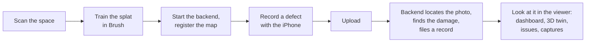
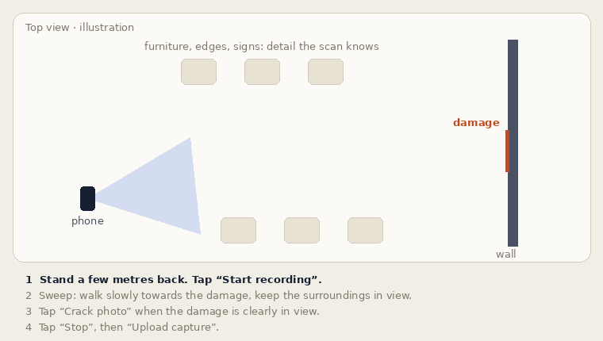
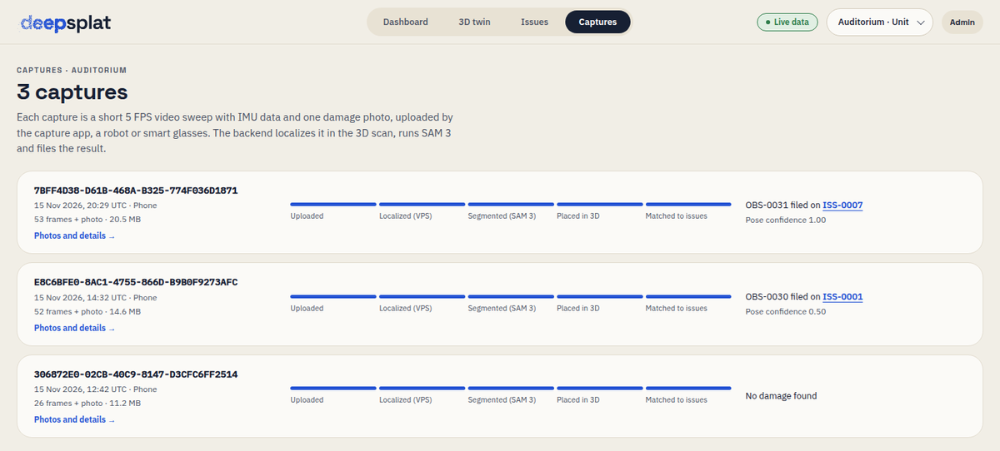
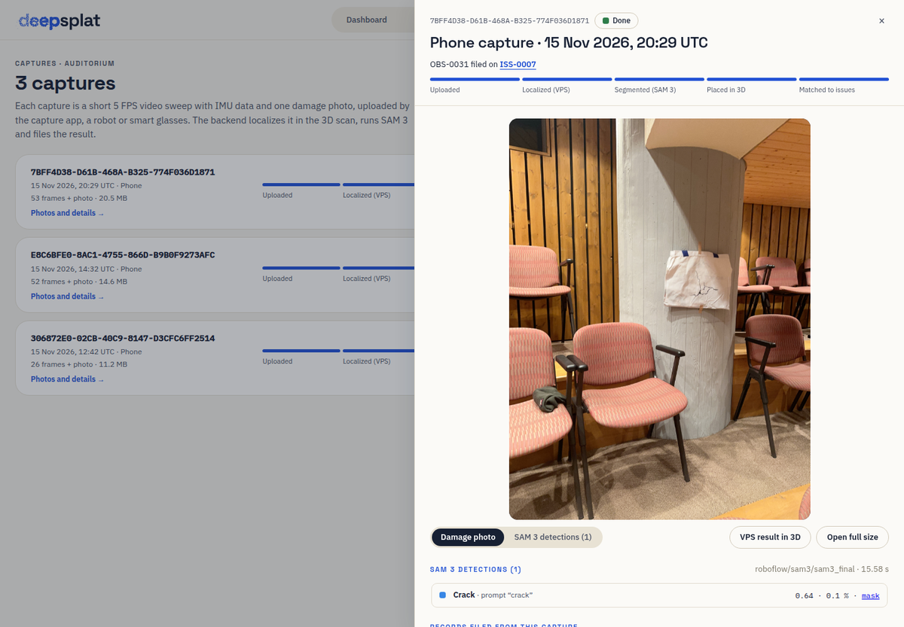
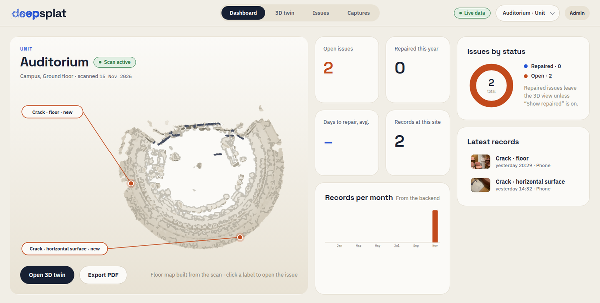
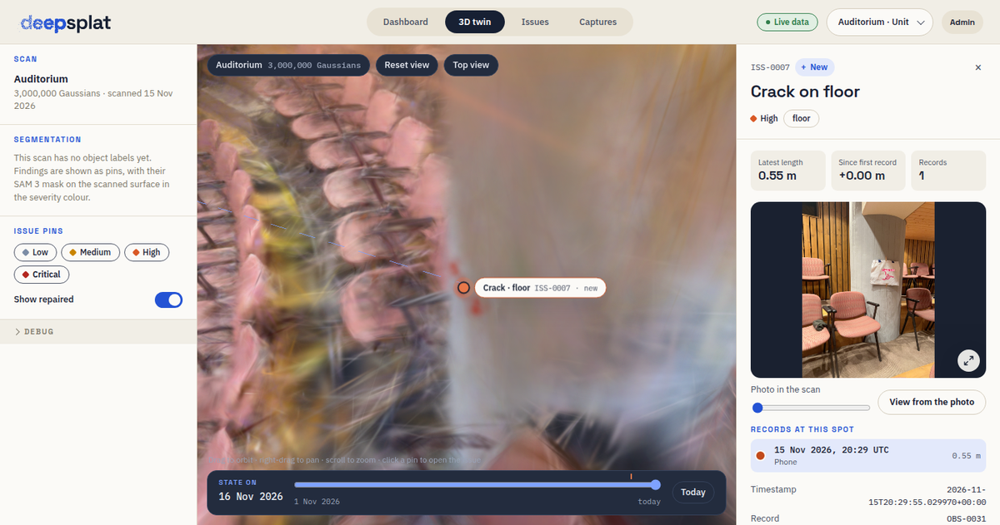
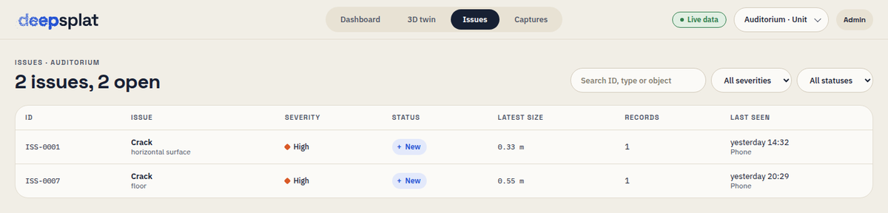

# deepsplat: user manual

How to use deepsplat, from scanning a space to working with the damage records. It describes the
`main` branch on 16 November 2026. How the system works inside is in the
[technical documentation](TECHNICAL.md).



The first three steps are done once per space. Recording and looking at the results repeat for
every inspection.

Open the part that matches what you are doing. Each part stands on its own.

The screenshots show the viewer with the project's auditorium scan and two test records. The
animation in the recording part is a drawn illustration, not a recording of the app.

| You are… | Open |
|---|---|
| scanning a space and making the 3D map | [Scanning](#scanning) |
| setting up the backend and the app | [Setting up](#setting-up) |
| recording damage with the iPhone | [Recording](#recording) |
| looking at records, reviewing, exporting | [Managing](#managing) |
| stuck | [Troubleshooting](#troubleshooting) |

**The words used here**

| Word | Meaning |
|---|---|
| Scan / splat | The 3D model of the space |
| Map | A splat registered in the backend under a **map ID**, for example `auditorium` |
| Capture | One upload from the app: a short video sweep and one photo of the damage |
| Issue | One damage at one place, for example `ISS-0003` |
| Record | One dated observation of an issue, for example `OBS-0007`. An issue collects records over time |
| Backend | The program that stores everything and does the processing. It runs on one computer |
| Viewer | The web page that shows the map and the records |

---

## Scanning

<details>
<summary><strong>1. Scan the space</strong></summary>

The project space was scanned with a handheld LiDAR scanner that has two cameras.

What the scan must deliver, whatever device is used:

* photos of the whole space,
* the position and direction of every photo,
* true scale, so that 1 unit is 1 metre,
* exported as a **COLMAP** folder:

```
<scan>/
├── images/…            the photos
└── sparse/0/
    ├── cameras.txt
    ├── images.txt
    └── points3D.txt
```

Advice that follows from how the system uses the scan:

* **Cover every place you will later inspect.** A damage photo can only be located where the scan
  has photos.
* **Walk the routes an inspector will walk**, and look at the surfaces they will photograph.
* **Scan in the lighting the space normally has.** Large lighting changes make locating harder.

</details>

<details>
<summary><strong>2. Train the splat in Brush</strong></summary>

1. Open [Brush](https://github.com/ArthurBrussee/brush).
2. Load the COLMAP folder of the scan.
3. Train with the default settings to **30,000 steps**.
4. Export the result as a `.ply` file, for example `splat_30000.ply`.

The project splat has 3 million gaussians and is 708 MB.

Do not move, rotate or rescale the splat afterwards in another program. The photos' positions must
keep matching it.

</details>

<details>
<summary><strong>3. Make views.zip</strong></summary>

The backend needs the scan's photos and their positions to locate later captures. Zip the COLMAP
folder's content, keeping the folders:

```bash
cd /path/to/<scan>
zip -r views.zip images sparse
```

For the project scan this file is 565 MB and holds 808 photos.

You now have the two files the backend needs: `splat_30000.ply` and `views.zip`. Continue with
[Setting up](#setting-up).

</details>

---

## Setting up

<details>
<summary><strong>1. Start the backend</strong></summary>

On the computer that holds the splat. Needs [uv](https://docs.astral.sh/uv/) and, for an https
address, `cloudflared`.

```bash
git checkout main && git pull
scripts/start-backend.sh --tunnel
```

On first start the script creates the file `.env`. Open it and set `ROBOFLOW_API_KEY` (needed for
damage detection), then start again.

When the backend is up it prints a box like this. Keep it; the app needs these three values.

```
  Web viewer (this machine):  http://localhost:8000/
  Web viewer (anywhere):      https://….trycloudflare.com/

  iOS app → Settings (switch Mock backend off):
    Backend URL:  https://….trycloudflare.com
    Token:        …
    Map ID, one of:
        auditorium   (Auditorium, map ready, localization ready)
```

Ways to start it:

| Command | Use when |
|---|---|
| `scripts/start-backend.sh --tunnel` | The phone is on any network. Gives an https address that changes at every start |
| `scripts/start-backend.sh` | Phone and computer are on the same network. Backend URL is `http://<computer IP>:8000` |
| `scripts/start-backend.sh --host mac.local` | Same network, with a fixed name instead of the IP |

Add `--no-sync` to skip installing packages on later starts. Stop the backend with Ctrl+C. All data
stays in the `data` folder and is there again at the next start.

</details>

<details>
<summary><strong>2. Register the splat as a map (once per map)</strong></summary>

With the backend running, in a second terminal:

```bash
scripts/register-map.sh auditorium /path/to/splat_30000.ply /path/to/views.zip "Auditorium"
```

* `auditorium` is the **map ID**. The app sends it with every capture.
* `"Auditorium"` is the name shown in the viewer.
* Without `views.zip` the map appears in the viewer, but captures cannot be located.

The backend then prepares the map: a lighter copy for the browser, a floor map and the localization
index. For the project splat this takes a few minutes. It is finished when the start script, or
`http://localhost:8000/maps/auditorium`, shows **status `ready`** and **vps_status `ready`**.

The backend assumes that z points up, which is the case for the project scan. (The `.ply` that Brush
exports says "Vertical axis: y" in its header; for the project scan that line is not correct, so do
not go by it.) If the vertical axis of your scan really is y, say so when registering:

```bash
METADATA='{"up_axis": "y"}' scripts/register-map.sh <map-id> <splat.ply> <views.zip> "<name>"
```

</details>

<details>
<summary><strong>3. Install the iPhone app</strong></summary>

Needs a Mac with Xcode 16 or newer and an iPhone with iOS 16 or newer.

```bash
brew install xcodegen
cd clients/ios
cp Local.xcconfig.example Local.xcconfig
# edit Local.xcconfig: set DEVELOPMENT_TEAM and a unique PRODUCT_BUNDLE_IDENTIFIER
xcodegen generate
open DeepSplatCapture.xcodeproj
```

In Xcode: add your Apple account under Settings → Accounts, connect the iPhone and trust the
computer, switch on Developer Mode on the iPhone, select the iPhone as target and press Run.

With a free Apple account the app stops opening after seven days; install it again from Xcode. If
the iPhone asks, trust the developer under Settings → General → VPN & Device Management.

</details>

<details>
<summary><strong>4. Connect the app to the backend</strong></summary>

In the app, tap the settings button (top right) and set:

| Setting | Value |
|---|---|
| **Inspection map** | the map ID, for example `auditorium` |
| **Mock backend** | **off**. It is on after installation, and then nothing is sent |
| **Backend URL** | the address the start script printed |
| **API token** | the token the start script printed (also `API_TOKEN` in `.env`) |
| **Upload on Wi-Fi only** | off, if the phone is the hotspot or uses mobile data |

Tap **Done**.

The app accepts `https` addresses, and plain `http` only for addresses on the local network, such
as `http://192.168.1.20:8000` or `http://mac.local:8000`. The first time, iOS asks for permission to
find devices on the local network; allow it.

</details>

---

## Recording

<details>
<summary><strong>Record a defect</strong></summary>



*Illustration of one capture, seen from above.*

1. On the home screen tap **Record defect**. Allow camera access when asked.
2. Wait until the pill at the top says **Tracking ready**.
3. Stand a few metres away from the damage and tap **Start recording**.
4. **Sweep:** move slowly towards the damage and let the camera see the surroundings: furniture,
   edges, signs, anything with detail. The frame counter goes up.
5. Tap **Crack photo** when the damage is clearly in view. **Photo saved** appears. **Retake photo**
   replaces it.
6. Tap **Stop**. It only works once a photo is saved.

Recording stops on its own at the maximum duration (20 seconds unless changed in Settings). If no
photo was taken by then, the app takes one at that moment.

</details>

<details>
<summary><strong>What makes a capture succeed</strong></summary>

The backend finds out where you stood by comparing your video frames with the scan. That decides
whether the damage can be placed.

* **Start far enough back.** A close-up of a plain wall cannot be located. The sweep is what locates
  the photo.
* **Show things with detail** during the sweep, from about the height and direction the scan saw
  them.
* **Move slowly.** If "Tracking limited. Move slowly towards a textured area." appears, slow down
  and point at something with detail until it goes away.
* **Keep the app open.** Switching to another app or a phone call stops the recording.
* **Sharp and bright photo.** Blurry or dark photos are held back for review.
* **Stay inside the scanned area.**

</details>

<details>
<summary><strong>Review and upload</strong></summary>

After **Stop** the Review screen shows the photo, the number of frames and the duration.

* **Upload capture** sends it. Nothing is sent before you tap this.
* **Export archive** shares the capture as a zip file instead.
* The bin icon deletes the capture from the iPhone.

Status texts:

| Text | Meaning |
|---|---|
| Saved on iPhone | Not sent yet |
| Queued / Preparing archive / Uploading N% / Confirming upload | On its way |
| Waiting for Wi-Fi | "Upload on Wi-Fi only" is on and there is no Wi-Fi |
| Upload failed · retry scheduled | It will try again by itself. **Retry upload** tries at once. The reason is shown on the Review screen |
| Uploaded · processing | The backend is working on it |
| Uploaded · done | The backend has finished |
| Uploaded · failed | Processing failed |
| Saved to mock backend | Mock backend is on. Nothing was sent |

Pull down on the list to refresh the status.

**"Done" does not mean a record was filed.** The app does not show results. Whether the capture was
located and what was found is shown in the viewer under **Captures**
([Managing](#managing)).

Captures stay on the iPhone after upload until you delete them. They are also visible in the Files
app under On My iPhone → DeepSplat.

</details>

<details>
<summary><strong>App settings</strong></summary>

| Setting | Default | Meaning |
|---|---|---|
| Inspection map | empty | Map ID. Recording is not possible while empty |
| Mock backend | on | On: captures are only copied on the iPhone |
| Upload on Wi-Fi only | off | On: waits for Wi-Fi. A phone hotspot does not count as Wi-Fi for this |
| Backend URL, API token | empty | From the backend's start script |
| Maximum duration | 20 sec | 5 to 60 |
| Include GPS hint | off | Stores one position fix with the capture |
| Advanced: Frame sampling | 5 fps | 1 to 15 |
| Advanced: Motion sampling | 100 Hz | 25 to 100 |
| Advanced: Frame JPEG quality | 90 % | 50 to 100 |

A capture that is already queued keeps the Backend URL, the Mock backend choice and the Wi-Fi-only
choice it was queued with. Changing these settings afterwards, or tapping **Retry upload**, does not
change them for that capture. A corrected token for the same URL is picked up.

</details>

---

## Managing

Open the viewer in a browser: `http://localhost:8000/` on the backend computer, or the https
address from the start script on any device. The chip in the top bar must say **Live data**. If it
says **Sample data**, the page did not reach a backend and shows invented examples.

Choose the map in the picker at the top right. The page refreshes itself every 4 seconds. All times
are UTC.

<details>
<summary><strong>Follow a capture after upload (Captures tab)</strong></summary>



Every upload appears here within a few seconds, newest first, and moves through five steps:

**Uploaded → Localized (VPS) → Segmented (SAM 3) → Placed in 3D → Matched to issues**

How it can end:

| Shown | Meaning | What to do |
|---|---|---|
| `OBS-…` filed on `ISS-…` | A record was created. Click it to see the issue in 3D | Nothing |
| No damage found | Located, but no crack detected in the photo | Retake the photo closer or sharper if there is damage |
| Damage found, not placed in 3D | Detected, but the spot has too few scan points | Record again from another angle |
| Stopped before "Localized (VPS)" · VPS could not localize | The frames did not match the scan | Record again; see "What makes a capture succeed" |
| Stopped before "Localized (VPS)" · Pose confidence … is below the 0.50 threshold | The frames did not agree well enough on one position | Record again with a longer, slower sweep |
| Stopped … · image quality: blurry / too_dark | Photo held back | Retake |
| Stopped … with another message | Processing failed, for example the detection service did not answer | Upload again, or ask the operator |



Click a capture for its details: the photo with the detections drawn in, each video frame, how it
was located, image sharpness and brightness, and the upload's checksum.

**Delete a capture:** at the bottom of the details, **Delete capture…**, then confirm. The page
asks once for the API token. Captures that filed records cannot be deleted; they are part of the
evidence log.

</details>

<details>
<summary><strong>Overview (Dashboard tab)</strong></summary>



* **Floor map** of the scan with a pin for every issue: rust = open, blue = repaired. Click a
  labelled pin to open the issue in 3D.
* **Open issues**, **Repaired this year**, **Days to repair, avg.**, **Records at this site**.
* **Records per month**, **Issues by status**, **Latest records**.
* **Open 3D twin** and **Export PDF**.

</details>

<details>
<summary><strong>Look at an issue in 3D (3D twin tab)</strong></summary>



**Moving:** drag to orbit, right-drag to pan, scroll to zoom. **Reset view** shows the whole scan,
**Top view** looks straight down. Esc clears the selection.

**Pins:** every issue has a pin, and its detected area is drawn on the scanned surface in the
severity colour. Click a pin to open the issue on the right.

**The issue panel shows:**

* type, severity, status, and the latest length or area with the change since the first record,
* the photo; with two or more records a slider compares the first and the latest photo. Click the
  photo to enlarge it; there you can switch between **SAM 3 detections** and **Original** and
  **Download** it,
* **Records at this spot:** every record with date and size. Click one to see its details,
* camera position, pose confidence, detection confidence, height above the floor and the record's
  hash,
* **Photo in the scan:** move the slider to fade the photo into the 3D scene at the place it was
  taken. **View from the photo** moves you to where the camera was,
* **PDF report.**

**Left panel:**

* **Issue pins:** switch severities on and off (Low, Medium, High, Critical) and **Show repaired**.
* **Debug:** the map's state and **Localization (VPS)**. Switch on **Capture poses** to see where
  every capture was located (green: accepted, amber: below the threshold), and pick a capture from
  the list to see each of its video frames.

**Time slider** (bottom): drag **State on** to a date to see the issues as they were on that day.
**Today** returns to now.

</details>

<details>
<summary><strong>Find an issue (Issues tab)</strong></summary>



A table of all issues: ID, type, severity, status, latest size, number of records, last seen.

* Search by ID, type or object.
* Filter by severity and by status (New, Worsening, Stable, Repaired).
* Click a row to open the issue in 3D.

How to read the status:

| Status | Meaning in the viewer |
|---|---|
| New | One record so far |
| Worsening | The latest record is more than 15 % larger than the first |
| Stable | Several records, no such growth |
| Repaired | A person confirmed the repair |

</details>

<details>
<summary><strong>Reports</strong></summary>

* **PDF:** **Export PDF** on the dashboard or **PDF report** in an issue. Both give the report for
  the whole map with its open issues.
* **CSV:** there is no button. Open `http://<backend>/maps/<map-id>/report.csv` in the browser.
* **Check the evidence log:** open `http://<backend>/maps/<map-id>/verify`. `"ok": true` means no
  stored record was changed or removed.

</details>

<details>
<summary><strong>Review a record, correct an issue, confirm a repair</strong></summary>

The viewer cannot change records. These actions are done with a request to the backend. Replace
`<backend>`, `<token>` and the IDs.

Confirm or reject a record (a rejected record means "this is not damage"):

```bash
curl -X PATCH <backend>/observations/OBS-0007 \
  -H "Authorization: Bearer <token>" -H "Content-Type: application/json" \
  -d '{"review": "rejected", "reviewed_by": "A. Reviewer"}'
```

An issue whose records are all rejected disappears from the viewer.

Mark an issue as repaired:

```bash
curl -X PATCH <backend>/issues/ISS-0003 \
  -H "Authorization: Bearer <token>" -H "Content-Type: application/json" \
  -d '{"status": "repaired", "by": "A. Reviewer"}'
```

Set the severity by hand (`low`, `medium`, `high`, `critical`), or correct the type:

```bash
curl -X PATCH <backend>/issues/ISS-0003 \
  -H "Authorization: Bearer <token>" -H "Content-Type: application/json" \
  -d '{"severity": "high"}'
```

The same actions are available as forms at `http://<backend>/docs`.

</details>

<details>
<summary><strong>What the measurements mean</strong></summary>

| Value | How to read it |
|---|---|
| Length (cracks) | The extent of the detected area along its longest direction, in metres |
| Area | The detected area in m², assuming the surface faces the camera. On a surface seen at an angle the value is too small |
| Height above floor | Height of the issue's position above the scan's floor |
| Pose confidence | 0 to 1. How well the video frames agreed on where the camera was. Below 0.50 nothing is filed |
| SAM 3 confidence | 0 to 1. How sure the detector is. Cracks below 0.45 are dropped |
| Severity | From the type and the size: a crack is Medium, High above 0.5 m, Critical above 1.5 m |

Positions and sizes are estimates from the 3D scan. Treat them as a guide for finding and comparing
damage, not as a survey measurement. Only cracks are detected at present.

</details>

---

## Troubleshooting

<details>
<summary><strong>The app does not upload</strong></summary>

| What you see | Cause | Fix |
|---|---|---|
| "Saved to mock backend" | Mock backend is on | Settings → Mock backend off |
| Upload stays at 0 % or "Waiting for Wi-Fi" | "Upload on Wi-Fi only" is on, and the phone is on mobile data or is the hotspot | Switch it off |
| "Enter an HTTPS backend URL and token…" | URL or token missing, or a plain `http` address that is not on the local network | Check both values |
| "Backend token was rejected (401)" | Wrong token | Copy `API_TOKEN` from `.env` again |
| "Backend request failed (HTTP 404)" | The map ID does not exist on this backend | Check the map ID |
| Fails after the address worked earlier | The tunnel address changed when the backend was restarted, or the computer's IP changed | Enter the new Backend URL |
| Nothing arrives at the backend at all | Phone and computer are not on the same network, or a firewall blocks port 8000 | Use `--tunnel`, or open the port |

The backend's terminal shows a line for every request it receives. No new line while the app tries
to upload means the phone is not reaching the computer.

</details>

<details>
<summary><strong>The capture arrives but no record appears</strong></summary>

Open the capture under **Captures** and read where it stopped; see the table in "Follow a capture
after upload". In most cases the sweep did not show enough of the scanned surroundings. Record again
from further back, more slowly, and with more of the room in view.

To check a single capture more closely, the operator can run
`uv run python tools/pose_check.py <capture-id>` (compares the photo with the scan from the computed
position) or `uv run python tools/rerun_capture.py <capture-id>` (processes it again).

</details>

<details>
<summary><strong>The viewer</strong></summary>

| What you see | Cause | Fix |
|---|---|---|
| "Sample data" chip | The page did not reach a backend | Open it from the backend's address |
| "No scan registered yet" | No map on this backend | Register one (Setting up, step 2) |
| "The backend is still preparing the floor plan…" | Map still being processed | Wait a few minutes |
| "The 3D viewer could not start" | No WebGL2, or no access to `cdn.jsdelivr.net` | Use a current browser with internet access |
| A new map is missing from the picker | The list of maps is read once | Reload the page |
| "Not deleted: …" or an error when deleting a capture | A known fault in the backend on `main` when it runs with the default data folder | See "Current state and known limitations" in the technical documentation |

</details>

<details>
<summary><strong>The backend</strong></summary>

| What you see | Cause | Fix |
|---|---|---|
| "uv is missing" / "cloudflared is missing" | Not installed | Install it, or start without `--tunnel` |
| Warning that `ROBOFLOW_API_KEY` is empty | No key in `.env` | Set it, or set `DETECTOR=fake` for a dry run without detection |
| Map `status` is `failed` | The splat could not be read | The file must be a binary 3DGS `.ply` |
| `vps_status` is `failed` | `views.zip` is missing, has no COLMAP or nerfstudio poses, or its poses do not match the splat | Check the zip's content; rebuild with `POST /maps/<id>/index` |
| Capture `failed` with a timeout or a Roboflow error | The detection service did not answer | Process it again: `uv run python tools/rerun_capture.py <capture-id>` |

</details>
